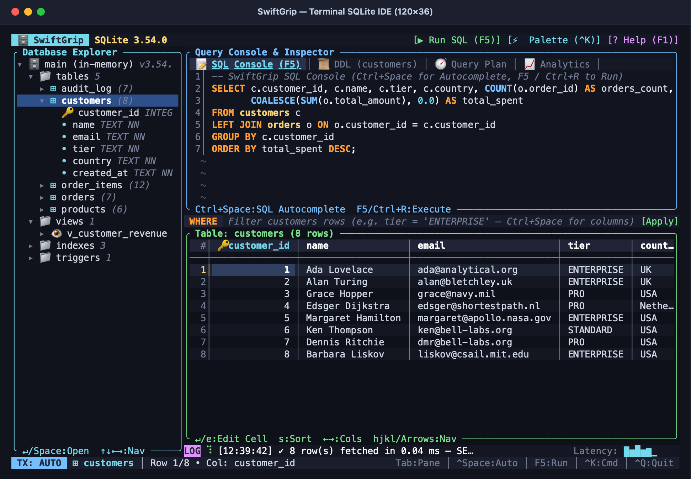
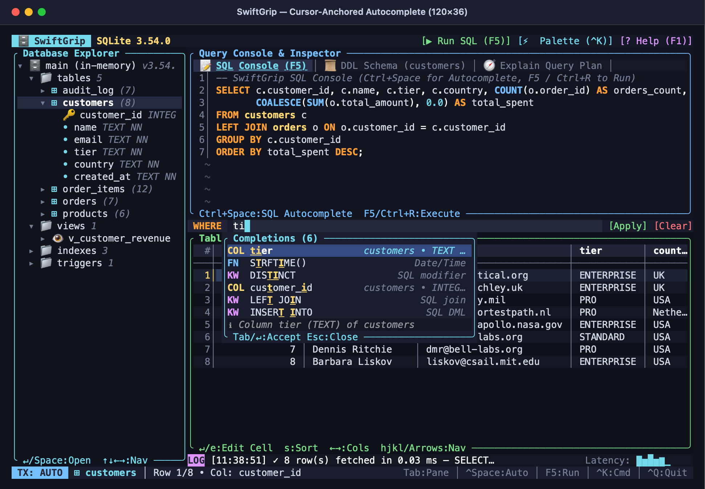
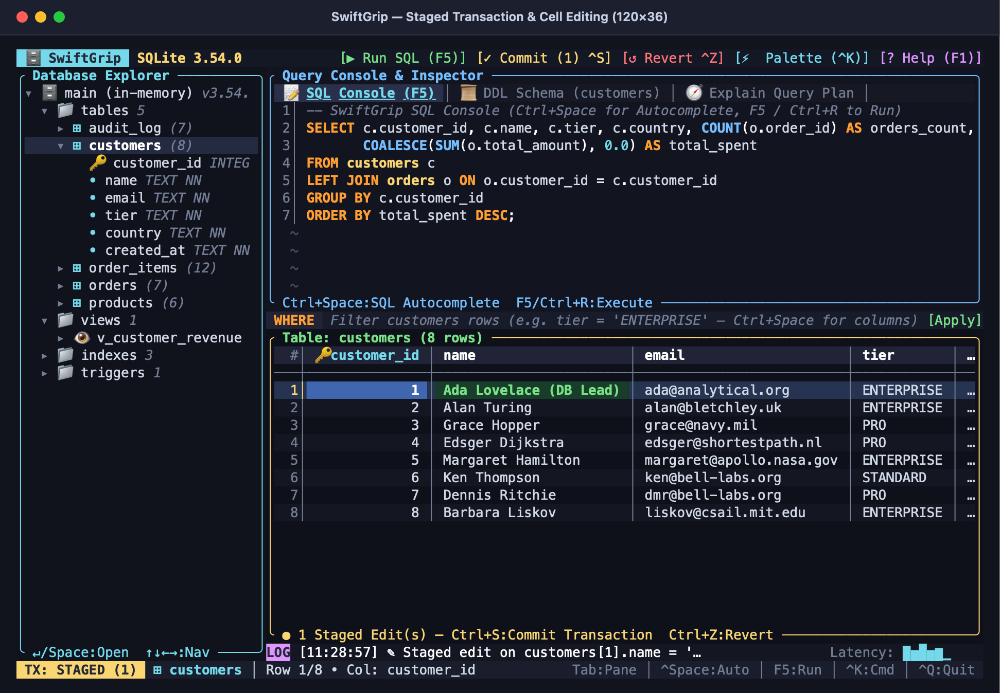
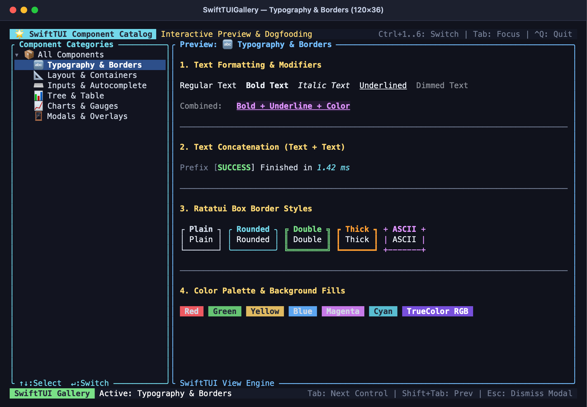
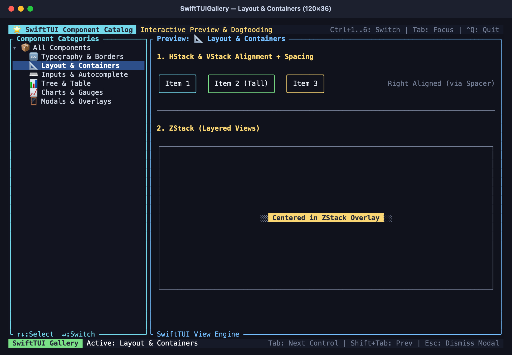
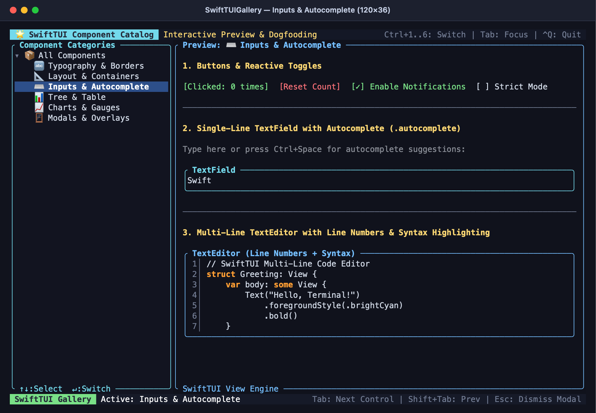
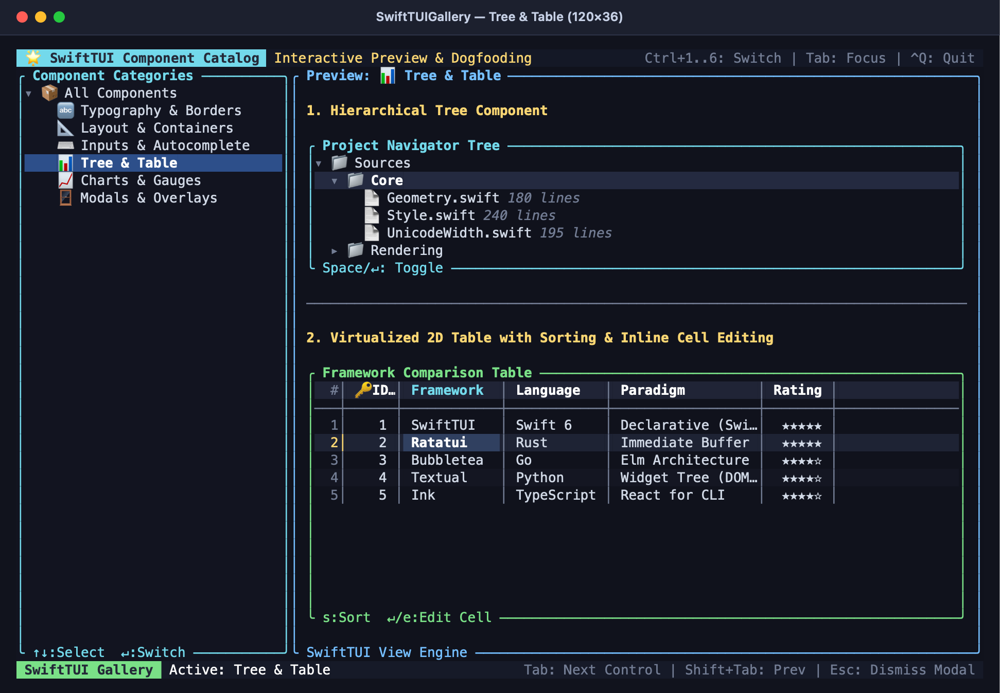
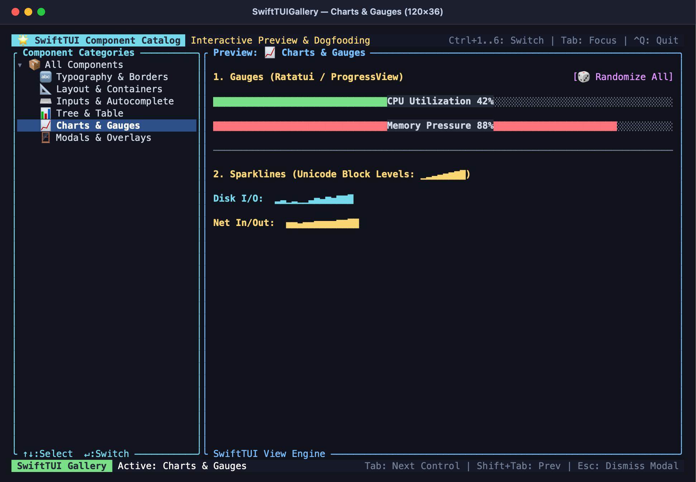
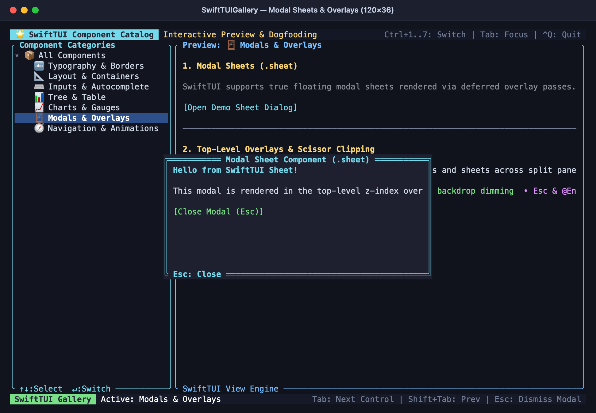

# SwiftTUI & SwiftGrip

**SwiftTUI** is a cross-platform Terminal User Interface (TUI) framework for Swift 6 inspired by **[Ratatui](https://ratatui.rs)** with a declarative **SwiftUI** API.

Included in this repository are two comprehensive sample projects:
1. **`SwiftGrip`**: An IntelliJ DataGrip-inspired terminal SQLite IDE built on `SwiftTUI` featuring a hierarchical Database Schema Explorer, multi-line SQL Console with syntax highlighting and **cursor-anchored SQL Autocomplete**, `EXPLAIN QUERY PLAN` inspector, and an interactive 2D Data Grid with inline cell editing and staged transactions.
2. **`SwiftTUIGallery`**: An interactive 6-category component showcase previewing every implemented view, container, chart, and input control in the framework.



*SwiftGrip running in a 120×36 terminal window with 3-pane layout, syntax-highlighted SQL editor, live data grid, and execution latency sparkline.*

<p align="center">
  
  
</p>

---

## Component Showcase (`SwiftTUIGallery`)

<p align="center">
  
  
</p>
<p align="center">
  
  
</p>
<p align="center">
  
  
</p>

---

## Comparison with Other TUI Frameworks

| Feature / Dimension | **SwiftTUI (This Project)** | **Ratatui** | **BubbleTea** | **Textual** | **Ink** |
| :--- | :--- | :--- | :--- | :--- | :--- |
| **Primary Language** | **Swift 6** | Rust | Go | Python | TypeScript / Node.js |
| **UI Paradigm** | **Declarative SwiftUI DSL** (`@ViewBuilder`, `@State`, `@Binding`, `@Observable`) | Immediate mode render closure (`terminal.draw(...)`) | Elm Architecture (`Init`, `Update`, `View`) | Widget Tree + Async DOM events + CSS | React reconciler for terminal CLI |
| **Double-Buffered Diffing** | **Yes** (SGR Delta encoding + `CSI ? 2026 h/l`) | **Yes** (industry gold standard) | Text buffer string diffing | Render tree invalidation | ANSI escape string patches |
| **Layout System** | **Two-Pass Proposed Size Negotiation** (`VStack`, `HStack`, `ZStack`, `HSplitView`) | Cassowary constraint solver / Flex (`Layout::default()`) | LipGloss box model (manual coordinate calculation) | CSS Grid / Flexbox | Yoga Flexbox |
| **State Reconciliation** | **Automatic Tree Reconciliation** with stable widget state paths | Manual user struct state ownership | Explicit TEA messages (`tea.Msg`, `tea.Cmd`) | Reactive attributes & DOM signals | React virtual DOM hooks |
| **Unicode & Wide Characters** | **UAX #11 full width**, Emoji, combining marks, continuation tracking | **Yes** (via `unicode-width`) | **Yes** (via `muesli/reflow`) | **Yes** (Rich engine) | Node string width approximations |
| **Floating Overlays & Popups** | **Deferred Z-Index Layer** (cursor-anchored autocomplete, `.sheet`) | `Clear` widget + manual rect slicing | Manual overlay stitching | DOM floating layers / modals | React portal simulation |
| **2D Table & Inline Editing** | **Built-in virtualized 2D grid** with sorting, PK tracking, staged edits | `Table` widget (read-only; edits require custom input tracking) | `bubbles/table` (read-only row selection) | `DataTable` widget with full events | Third-party table components |
| **External Dependencies** | **Zero** (Pure Swift Standard Library + Darwin/Glibc + SQLite C API) | Minimal (Crossterm backend) | Minimal (Termenv, Lipgloss) | Heavy (Rich, AsyncIO, PyPI deps) | Heavy (Node runtime, React, Yoga) |

---

## Features

- **Zero External Dependencies**: Pure Swift 6 using only the Swift Standard Library, `Observation`, `Foundation`, `Darwin`/`Glibc` (`termios`/`ioctl`), and system `sqlite3`.
- **Ratatui-Grade Cell Buffer & Diff Renderer**:
  - Double-buffered 2D [`Buffer`](Sources/SwiftTUI/Rendering/Buffer.swift) with East Asian Wide / Emoji grapheme width calculation ([`UnicodeWidth`](Sources/SwiftTUI/Core/UnicodeWidth.swift)) and automatic orphaned half-cell cleanup.
  - Minimal ANSI/VT escape diffing ([`DiffRenderer`](Sources/SwiftTUI/Rendering/DiffRenderer.swift)) wrapped in synchronized output (`CSI ? 2026 h` / `l`).
  - Deferred top-level overlay z-layer so cursor-anchored popovers (`AutocompletePopup`) and modals (`.sheet`) float cleanly over split panes without clipping.
- **Declarative SwiftUI Subset & Animation Engine**:
  - `App`, `Scene`, `WindowGroup`, `View`, and variadic parameter-pack `@ViewBuilder`.
  - Retained state reconciliation supporting `@State`, `@Binding`, `@Observable`, `@FocusState`, and `@Environment`.
  - **Full Declarative Animation Engine**: timing curves (`.linear`, `.easeIn`, `.easeOut`, `.easeInOut`), damped harmonic spring physics (`.spring`, `.bouncy`), `VectorArithmetic`, TrueColor 24-bit RGB lerp, `withAnimation`, `AnimatableValue`, and `TimelineView` (30fps/60fps periodic scheduling).
  - Two-pass layout negotiation (`ProposedViewSize` -> `Size`) with `VStack`, `HStack`, `ZStack`, `Spacer`, `Divider`, `ScrollView`, `GeometryReader`, and mouse-draggable `HSplitView` / `VSplitView`.
- **Rich Terminal Widgets, Visualizations & Autocomplete**:
  - `TextField` and multi-line `TextEditor` (line numbers, syntax highlighting hook, cursor-anchored `AutocompletePopup`).
  - Hierarchical `Tree` and virtualized 2D `Table` with column sorting, row/cell selection, and inline cell editing with staged rollback transactions.
  - **Ratatui-Grade Visualizations**: `BarChart` (vertical & horizontal with 1/8th fractional Unicode blocks), `Canvas` (2×4 sub-pixel Braille matrix `U+2800..U+28FF` with Bresenham lines, circles, and mathematical curve plotting), `Gauge`, and `Sparkline`.
  - **Bubble Tea Parity Spinners**: `Spinner` with multi-frame presets (`.dots`, `.line`, `.pulse`, `.arc`, `.meter`).
  - `TabBar`, `Button`, `Toggle`, `.sheet`, and `.keyboardShortcut`.
- **Terminal Protocols & Input Handling**:
  - SGR 1006 mouse tracking (clicks, drags, motion, scroll wheel).
  - Kitty / CSI u extended keyboard protocol & ANSI CSI/SS3 decoding.
  - Bracketed paste (`CSI ? 2004 h/l`) for safe multi-line pastes.
  - Terminal window focus reporting (`CSI ? 1004 h/l`).
- **Headless Testing & High-Resolution Screenshot Engine (`SwiftTUITesting`)**:
  - Drive any `View` in unit tests via [`TestHarness`](Sources/SwiftTUITesting/TestHarness.swift) with synthetic keyboard/mouse events and buffer assertions.
  - Export pixel-perfect macOS Terminal PNG screenshots via [`TerminalScreenshotRenderer`](Sources/SwiftTUITesting/TerminalScreenshotRenderer.swift) using native AppKit font rasterization, or vector SVG documents cross-platform.

---

## Quick Start

### 1. Run the `SwiftTUIGallery` Component Catalog (All Views Preview)

Preview every implemented view and control in an interactive multi-pane showcase:

```bash
# Launch interactive gallery:
swift run SwiftTUIGallery

# Jump directly to a category:
swift run SwiftTUIGallery typography
swift run SwiftTUIGallery layout
swift run SwiftTUIGallery inputs
swift run SwiftTUIGallery "Tree & Table"
swift run SwiftTUIGallery charts
swift run SwiftTUIGallery modals

# Render a headless text snapshot to stdout:
swift run SwiftTUIGallery --snapshot

# Save high-resolution PNG screenshot:
swift run SwiftTUIGallery --screenshot gallery.png
```

### 2. Run the `SwiftGrip` SQLite IDE

```bash
# Launch with the built-in relational e-commerce demo database:
swift run SwiftGrip

# Open or create a local SQLite database file:
swift run SwiftGrip path/to/database.sqlite

# Render a headless text snapshot to stdout:
swift run SwiftGrip --snapshot

# Save high-resolution PNG screenshot:
swift run SwiftGrip --screenshot swiftgrip.png
```

### 3. Run the Test Suite

```bash
CLANG_MODULE_CACHE_PATH=/tmp/clang-module-cache swift test --disable-sandbox
```

### Minimal `SwiftTUI` App Example

```swift
import SwiftTUI

struct CounterApp: App {
    var body: some Scene {
        WindowGroup {
            CounterView()
        }
    }
}

struct CounterView: View {
    @State private var count = 0
    @State private var query = ""

    var body: some View {
        VStack(alignment: .leading, spacing: 1) {
            Text("SwiftTUI Counter: \(count)")
                .bold()
                .foregroundStyle(.brightCyan)

            HStack(spacing: 2) {
                Button("Increment (+)") { count += 1 }
                Button("Decrement (-)") { count -= 1 }
            }

            TextField("Type SQL keyword...", text: $query)
                .autocomplete { ctx in
                    ["SELECT", "FROM", "WHERE", "JOIN", "GROUP BY", "ORDER BY"]
                        .filter { $0.lowercased().hasPrefix(ctx.prefix.lowercased()) }
                        .map { AutocompleteItem(label: $0, insertText: "\($0) ", kind: .keyword) }
                }
        }
        .padding(1)
        .border(.rounded, color: .brightCyan, title: "Demo")
    }
}
```
